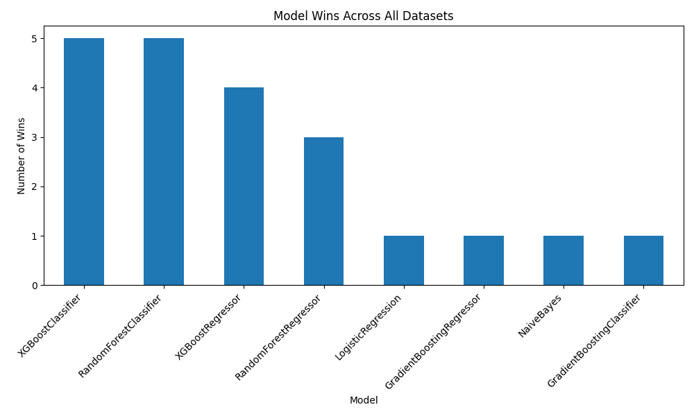
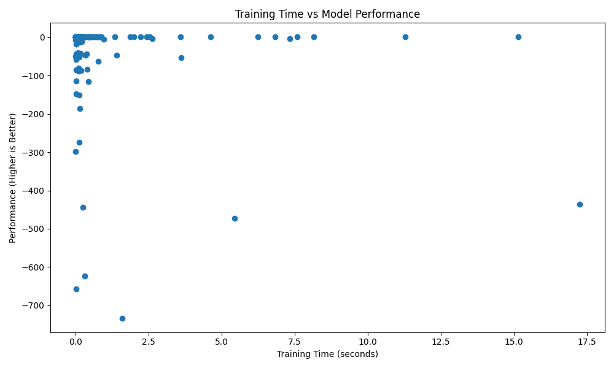

# AutoML Benchmarking System: 8 Models × 20+ Datasets

An AutoML system that automatically detects the task, preprocesses the data, **tunes hyperparameters with cross-validation**, and then trains, evaluates, ranks and visualizes classical machine learning models across many datasets, so you can see **which model works best, where, and why**.

The focus is on system design and experimentation rather than on any single dataset: one command runs the full pipeline on every dataset in the registry, survives broken datasets without crashing, and produces per-dataset and global model rankings.

## Features

- **Automatic task detection**: works out whether each dataset is classification or regression from its target column.
- **Automatic preprocessing**: mean imputation and scaling for numeric features, most-frequent imputation and one-hot encoding for categorical ones.
- **Hyperparameter tuning**: each model is tuned with `RandomizedSearchCV` (10 candidate settings, 3-fold cross-validation on the training data only) using the same metric it is ranked on, then refit with its best settings. Falls back to defaults if tuning fails.
- **Multi-model training**: trains up to 8 classifiers or 6 regressors per dataset and records the training time (including tuning) for each.
- **Evaluation**: Accuracy, weighted F1 and ROC-AUC (binary) for classification; RMSE and R² for regression.
- **Ranking**: ranks models within each dataset, then globally by number of wins.
- **Fault tolerance**: datasets that fail to load or train are logged to `failed_datasets.csv` and skipped.
- **Visualization**: model-wins bar chart and training-time vs performance scatter plot.

## Models

| Classification | Regression |
| --- | --- |
| Logistic Regression | Linear Regression |
| K-Nearest Neighbors | Decision Tree |
| Gaussian Naive Bayes | Random Forest |
| Decision Tree | Gradient Boosting |
| Random Forest | AdaBoost |
| Gradient Boosting | XGBoost |
| AdaBoost | |
| XGBoost | |

XGBoost is optional: if it isn't installed, those models are skipped. Search spaces for every model live in `Pipeline/models.py`.

## Datasets

About 30 datasets are registered in `Datasets/dataset_registry.py`, a mix of classification and regression problems from:

- **scikit-learn**: iris, wine, breast_cancer, diabetes, california_housing and more
- **OpenML**: adult, titanic, bank-marketing, credit-g, mushroom, spambase, house_prices, energy_efficiency and more

Adding a dataset is as simple as adding one entry to the registry.

## Results

### Effect of tuning

On the built-in scikit-learn datasets, tuning improved the best score on the harder problems and kept the easy ones perfect:

| Dataset | Metric | Default settings | Tuned |
| --- | --- | --- | --- |
| breast_cancer | best F1 (higher is better) | 0.974 | **0.982** |
| diabetes | best RMSE (lower is better) | 53.7 | **52.7** |
| iris, wine | best F1 | 1.000 | 1.000 |

### Baseline benchmark (default hyperparameters)

In the full baseline run, 22 dataset runs completed and 8 were logged as failures. Number of datasets on which each model ranked #1:

| Model | Wins |
| --- | --- |
| RandomForestClassifier | 5 |
| XGBoostClassifier | 5 |
| XGBoostRegressor | 4 |
| RandomForestRegressor | 3 |
| GradientBoostingClassifier | 1 |
| GradientBoostingRegressor | 1 |
| LogisticRegression | 1 |
| NaiveBayes | 1 |

**Key takeaway:** ensemble methods (Random Forest, XGBoost, Gradient Boosting) won 19 of 21 dataset comparisons. Simpler models still won occasionally (Logistic Regression on breast_cancer, Naive Bayes on titanic), and they train far faster.





Full baseline results are in the `Results/` folder. Run `python main.py` to regenerate them with tuning enabled.

## Project structure

```
ml-benchmarking-platform/
├── main.py                  # Entry point: runs everything and saves rankings
├── experiment_runner.py     # Loops over datasets: load → detect → split → train → evaluate
├── requirements.txt
├── Datasets/
│   ├── dataset_registry.py  # List of datasets and where to load them from
│   ├── loader.py            # Loads a dataset into pandas (X, y)
│   └── detector.py          # Classification vs regression detection
├── Pipeline/
│   ├── preprocessing.py     # Train/test split and preprocessing pipeline
│   ├── models.py            # Model definitions and hyperparameter search spaces
│   ├── trainer.py           # Tunes, trains and times every model
│   ├── evaluator.py         # Computes metrics
│   └── ranking.py           # Per-dataset and global rankings
├── Results/                 # CSV outputs from the latest run
└── Visuals/                 # Plotting scripts and charts
```

## Getting started

```bash
git clone https://github.com/itsAreebb/ml-benchmarking-platform.git
cd ml-benchmarking-platform
pip install -r requirements.txt
python main.py
```

The run downloads OpenML datasets on first use, so it needs an internet connection. With tuning on, the full run takes a while (roughly 10 to 20 times longer than without it). For a quick run, set `TUNE = False` at the top of `main.py`; you can also change `N_ITER` and `CV_FOLDS` there. When it finishes it writes `results_all_datasets.csv`, `ranked_results_all_datasets.csv`, `global_model_ranking.csv` and `failed_datasets.csv`, and prints the top models.

To regenerate the charts, move the CSVs into `Results/` and run:

```bash
python Visuals/visualize.py
```

## Tech stack

Python · scikit-learn · XGBoost · pandas · NumPy · SciPy · Matplotlib · tqdm
